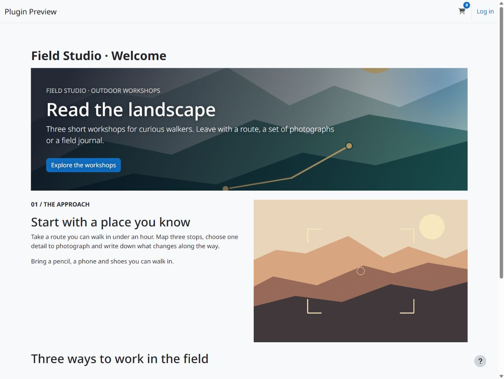
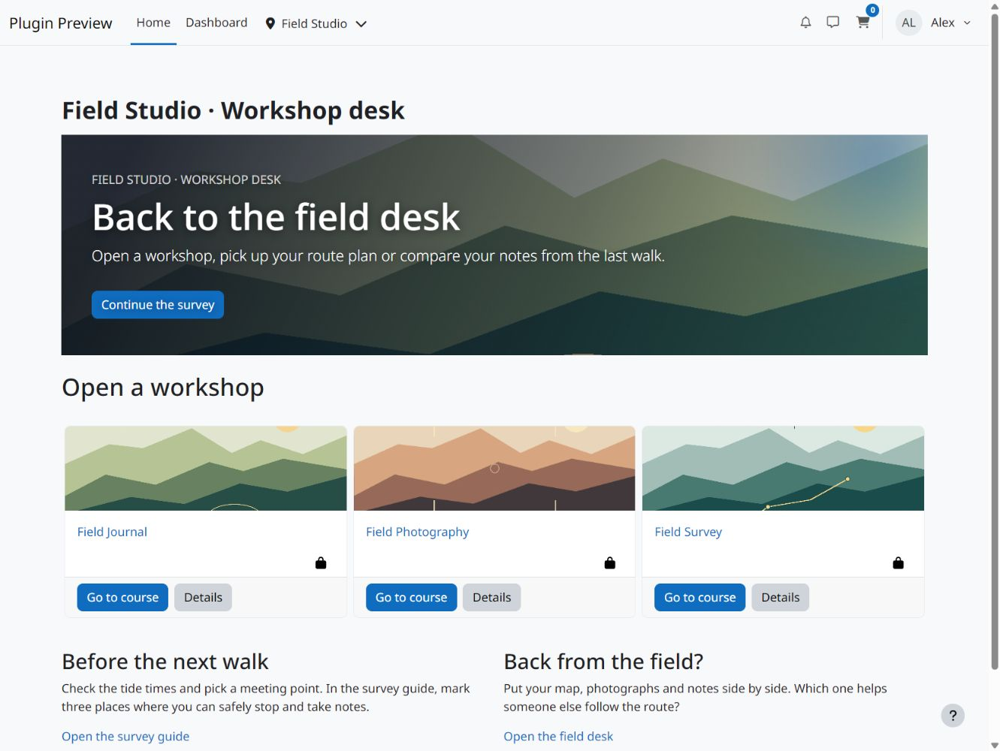
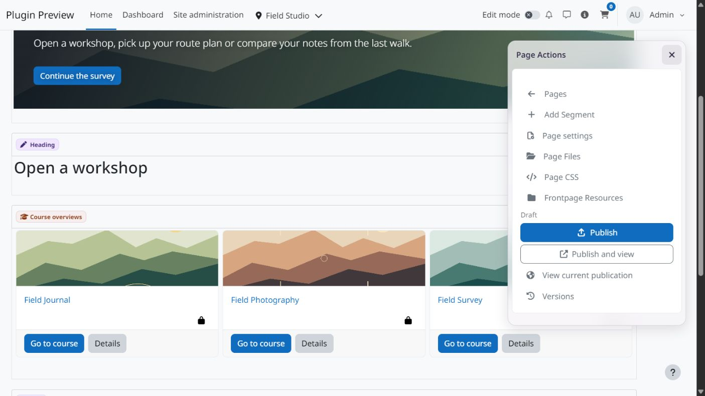
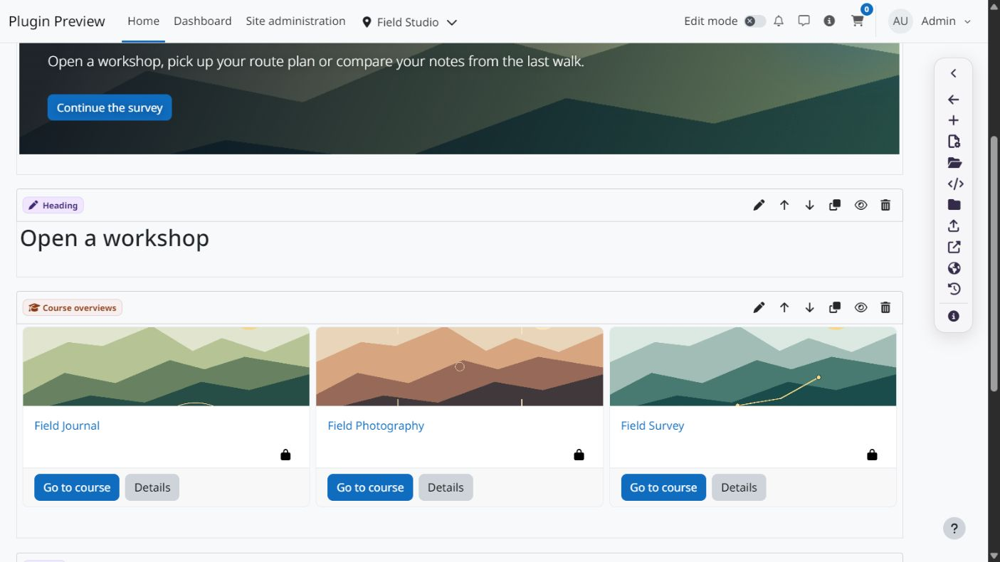
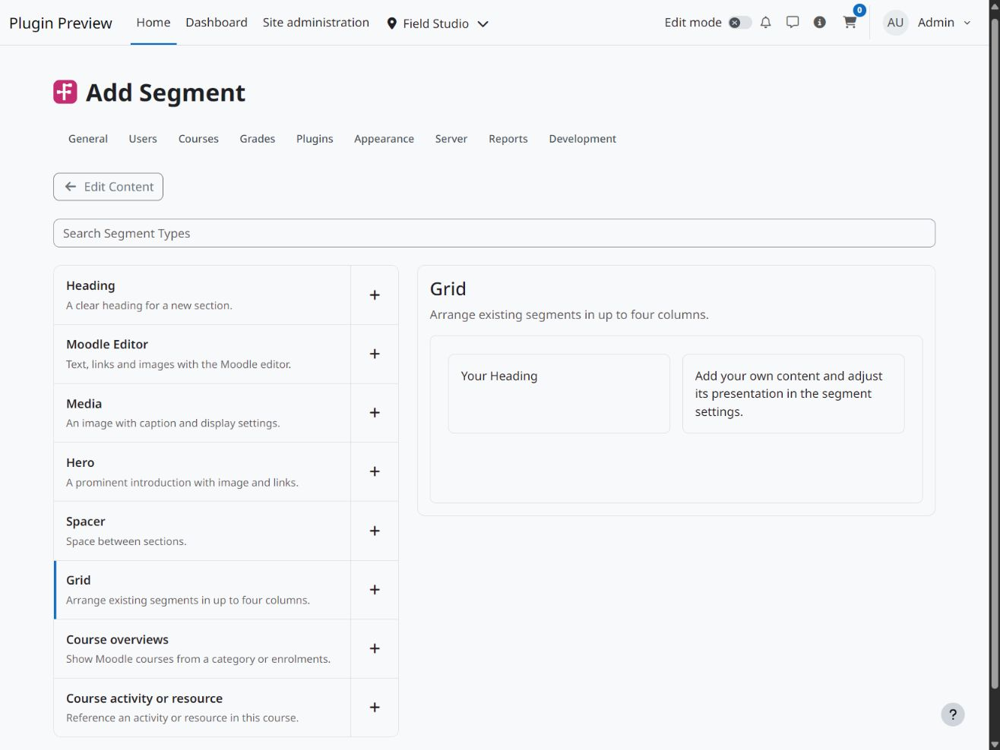

  

# Frontpage LE

Create a Moodle Site Home page with headings, rich text, images, a static Hero and responsive grids. Add Moodle course lists and references to activities in the Site Home course.

## Screenshots

View screenshots

## Installation

Supports Moodle 4.5 through 5.3. Download the [signed beta ZIP](https://github.com/108design/moodle-local_frontpage-le/releases) and install it as `local/frontpage`.

Open **Site administration > Plugins > Local plugins > Frontpage**. Create up to five pages and save their content as drafts. Preview them while you experiment. Under **Settings**, assign pages separately to guests and signed-in users, then publish the assigned pages and enable **Replace Site Home**. Only those two assignments can be published or viewed publicly. Changing an assignment returns the previous page to a private draft while keeping its content and revisions. Both audiences can use the same page. Switching the replacement off returns to Moodle’s native Site Home. Native Site Home must be enabled; Moodle’s default home page and forced-login settings still apply.

Managers with **Manage Frontpage pages** can edit content. **Publish Frontpage pages** controls publication separately. Files and earlier revisions remain associated with their pages. Use **Versions** to preview an earlier revision or restore it as a new draft.

## Course activities

Add [Frontpage Course Activity](https://github.com/108design/moodle-mod_frontpage-le) to build pages inside courses. Teachers edit in the activity’s own context. Moodle controls course access, availability and completion.

Open **Activity navigation** in the course activity editor to choose whether linked activities show Previous and Next, and whether the sequence ends at the Frontpage overview or continues in the course. Save the draft and publish it to apply the settings. The sequence follows accessible references in the published page and its Grids; repeated references count once. A separate return link opens the original card.

Moodle 5.3 uses its native navigation components and offers the course setting where the format supports it. Moodle 4.5 to 5.2 use a compatible footer and retain completion in the activity header. Native activity forms keep their own workflow. Course-level links leave the Frontpage sequence. Draft and historical previews use ordinary activity links.

## Resources and recovery

Choose an existing activity from the same course, or open Moodle’s activity chooser with **Create Activity or Resource**. Removing a segment removes its reference; the activity and its user data remain.

**Frontpage Resources** is available in the course navigation and remains accessible after the source page is deleted. Retained revisions protect their activity references. Resources created through Frontpage become deletion candidates after 30 days without retained references. Deletion requires confirmation and removes the native activity and its user data. Review other links and uses before deleting it. Earlier revisions can be removed individually; the current draft and publication are protected.

For Site Home recovery, keep a consistent backup of the full Moodle database, `moodledata` and `config.php`, together with the matching plugin code. Restore the database and file data together to retain IDs, audience settings, revisions and files. A course-activity backup does not contain Site Home. Keep backups outside the live web directory and test recovery.

## Page CSS

Use the page CSS action in the editor to save a stylesheet in the current draft. Preview and publication follow the same revision as the content. The stylesheet is loaded on the page view; authoring forms remain available for recovery. Page CSS has its own permission, including for CSS changes made through a revision restore. Site managers need an explicit grant; course activity editors use the native module CSS permission. The editor bundle contains CodeMirror under MIT; its source and locked build are included.

## License

This release is available free of charge under the 108design Software License.

See [LICENSE.md](LICENSE.md) for the terms and Moodle Marketplace permission.
